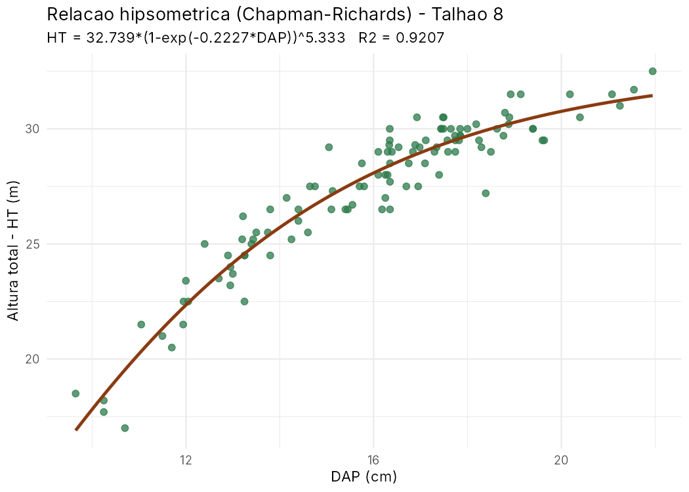

<div align="center">

# 🌲 Desafio 02 — Altura e relação hipsométrica

**Estimativa da altura das árvores não medidas a partir do DAP**

   

*Disciplina Mensuração Florestal · Programa de Pós-Graduação em Ciências Florestais · ICA/UFMG*

</div>

## 📋 Objetivo

Identificar o padrão de amostragem da altura no inventário, ajustar a relação hipsométrica com as árvores medidas, estimar a altura das demais e avaliar o viés de calcular a altura média apenas com a subamostra.

## 🗂️ Dados

Mesmo inventário do [Desafio 01](https://github.com/danieldias936-cyber/desafio-diametro-eucalipto): talhão 8, 6 parcelas, 215 árvores. A altura (HT) foi medida apenas nas fileiras centrais (3, 4 e 5) de cada parcela: 109 árvores (50,7%).

Arquivo: [`dados/inventario.xlsx`](dados/inventario.xlsx).

## 🔧 Métodos

Seis modelos hipsométricos ajustados com as 109 árvores medidas e comparados na escala original (metros):

| Modelo | R² | AIC |
|---|:-:|:-:|
| Linear simples | 0,852 | 51,81 |
| Henricksen | 0,894 | 15,48 |
| Curtis | 0,866 | 41,04 |
| Stoffels (corrigido por Meyer) | 0,864 | — |
| Quadrático | 0,917 | −9,31 |
| **Chapman-Richards** | **0,921** | **−13,94** |

## 📈 Principais resultados

**Modelo selecionado: Chapman-Richards**

$$HT = 32{,}739 \cdot \left(1 - e^{-0{,}2227 \cdot DAP}\right)^{5{,}333}$$

- Maior R² e menor AIC; resíduos sem padrão e normais (Shapiro-Wilk: p = 0,517).
- A assíntota estimada (32,74 m) praticamente coincide com a maior altura medida no talhão (32,5 m).
- Altura média do talhão: **27,00 m** com a base completa contra **27,42 m** usando só as árvores medidas, superestimativa de 1,58%.
- Altura dominante média do talhão: **30,6 m**.

<p align="center">
  <br>
  <sub><b>Relação DAP × altura com a curva de Chapman-Richards ajustada</b></sub>
</p>

## 📁 Estrutura do repositório

```text
desafio_altura/
├── dados/
│   └── inventario.xlsx                 # inventário original (HT = 0 = não medida)
├── scripts/
│   └── 01_relacao_hipsometrica.R       # ajuste, seleção e aplicação do modelo
├── resultados/
│   ├── tabelas/
│   │   └── inventario_completo.xlsx    # 215 árvores com HT medida ou estimada
│   └── figuras/
│       └── grafico_hipsometrico.png
└── docs/
    ├── enunciado.pdf
    └── relatorio.pdf
```

## ▶️ Como executar

A partir da raiz do repositório:

```r
install.packages(c("readxl", "writexl", "dplyr", "ggplot2", "minpack.lm"))
```

```bash
Rscript scripts/01_relacao_hipsometrica.R
```

## 📄 Documentos

- 📝 [Enunciado](docs/enunciado.pdf)
- 📊 [Relatório](docs/relatorio.pdf)

## 🧭 Série de desafios

| # | Desafio | |
|:-:|---|:-:|
| 01 | [Diâmetro](https://github.com/danieldias936-cyber/desafio-diametro-eucalipto) | |
| **02** | **Altura e relação hipsométrica** | 📍 você está aqui |
| 03 | [Volume e forma](https://github.com/danieldias936-cyber/desafio_volume-e-forma) | |
| 04 | [Volume reduzido e equações de volume](https://github.com/danieldias936-cyber/desafio-04-volume-reduzido-e-tabela) | |
| 05 | [Taper e sortimento](https://github.com/danieldias936-cyber/desafio_taper_e_sortimento) | |
| 06 | [Amostragem de Bitterlich](https://github.com/danieldias936-cyber/desafio-06-bitterlich) | |
| 07 | [Classificação de sítios florestais](https://github.com/danieldias936-cyber/desafio-07-classificacao-sitio) | |
| 08 | [Validação do índice de sítio](https://github.com/danieldias936-cyber/desafio-08) | |
| 09 | [Crescimento e produção (Clutter)](https://github.com/danieldias936-cyber/desafio-09) | |

## 👤 Autor

**Daniel Dias** · [@danieldias936-cyber](https://github.com/danieldias936-cyber)  
Mestrado em Ciências Florestais — ICA/UFMG, Montes Claros (MG)
